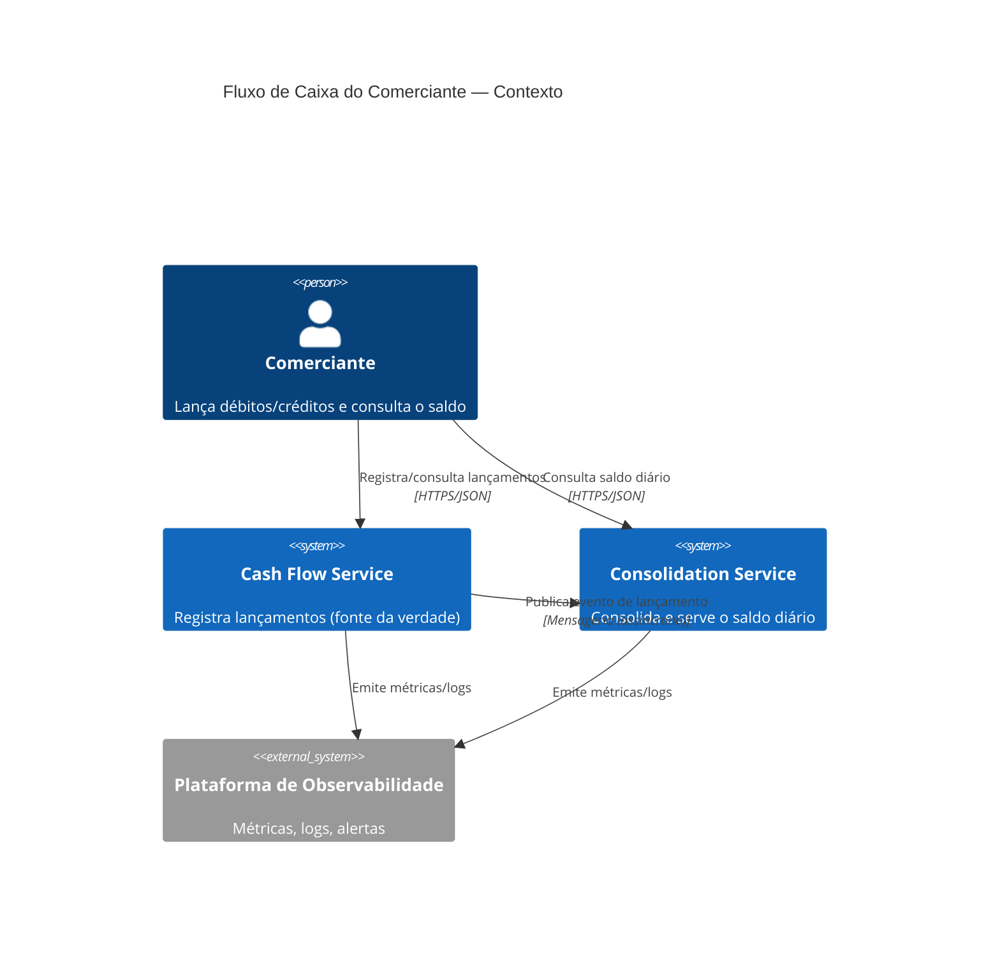
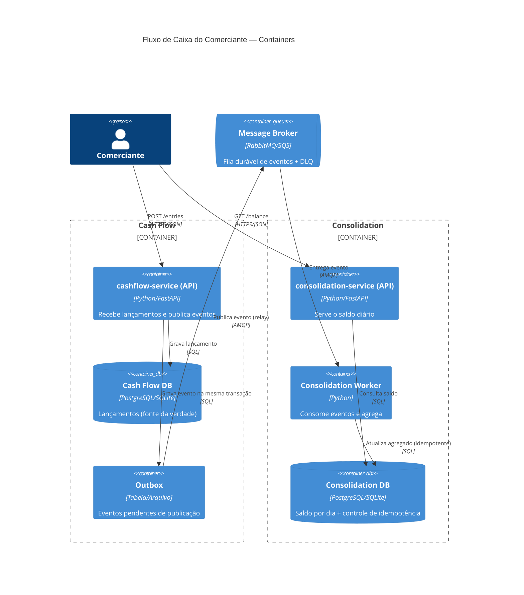
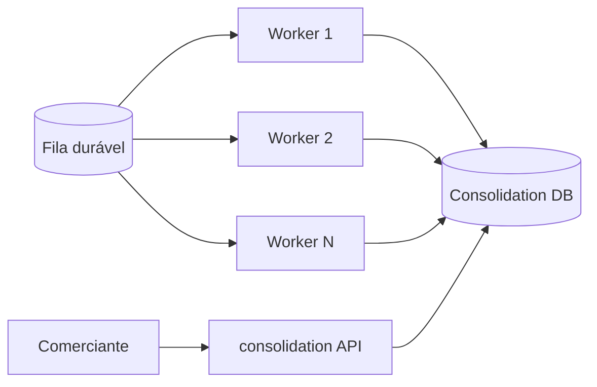
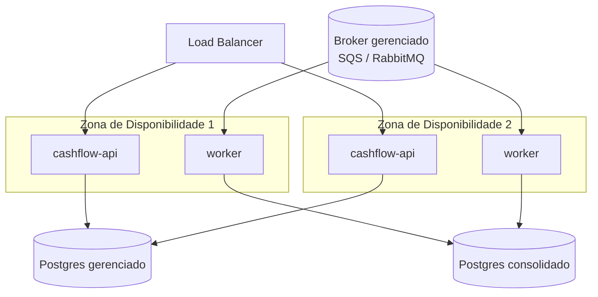

# 03 — Arquitetura Alvo

## 1. Visão geral (C4 — Nível 1: Contexto)



## 2. Containers (C4 — Nível 2)



## 3. Fluxo crítico — “lançar não depende do consolidar”

```mermaid
sequenceDiagram
    autonumber
    participant M as Comerciante
    participant CF as cashflow-service
    participant DB as Cash Flow DB (+Outbox)
    participant Q as Broker (fila durável)
    participant W as consolidation-worker
    participant CDB as Consolidation DB

    M->>CF: POST /entries (crédito/débito)
    CF->>DB: BEGIN; INSERT lançamento; INSERT outbox; COMMIT
    CF-->>M: 201 Created  ✅ (confirmado SEM depender do consolidado)
    Note over Q: se o worker estiver parado, os eventos só ACUMULAM — o Cash Flow segue 100%
    DB-->>Q: relay publica evento
    Q->>W: entrega evento
    W->>CDB: upsert saldo do dia (idempotente por event_id)
    W-->>Q: ack

    alt worker falha após N tentativas
        Q->>Q: move para DLQ
    end
```

**O ponto arquitetural:** o `201` é devolvido **após o commit local**. O consolidado é
um **consumidor desacoplado**. Se ele cair, o comerciante **continua lançando** — os
eventos ficam duráveis e são processados quando o consumidor voltar.

## 4. Fluxo do consolidado (50 req/s)



- **Escala horizontal do consumo:** N workers leem a mesma fila (competing consumers).
- **Leitura separada da escrita:** a API de consulta lê o agregado já materializado, não
  recalcula on-the-fly — mantém a latência de leitura baixa sob pico.
- **Agregado materializado** (`DailyBalance`): o saldo é mantido por *upsert incremental*,
  não por `SUM()` a cada leitura.

## 5. Estilos arquiteturais avaliados

| Estilo | Atende RNF-01? | Atende 50 req/s? | Complexidade | Decisão |
|---|---|---|---|---|
| Monólito único | ✅ (mas acopla) | ✅ | Baixa | ❌ Não separa os domínios pedidos |
| **Serviços + evento assíncrono** | ✅ | ✅ | Média | ✅ **Escolhido** |
| Chamada síncrona (REST A→B) | ❌ quebra RNF-01 | ⚠️ acopla latências | Baixa | ❌ Veta o requisito central |
| CQRS completo (write/read models separados p/ ambos) | ✅ | ✅ | Alta | 🟡 Over-engineering para o porte — **leitura materializada** já entrega o essencial |

## 6. Padrões aplicados (e por quê)

| Padrão | Onde | Por quê |
|---|---|---|
| **Bounded Contexts (DDD)** | Domínio | Separa as duas razões de mudança |
| **Transactional Outbox** | Cash Flow | Garante que “gravar lançamento” e “publicar evento” sejam **atômicos** |
| **Competing Consumers** | Consolidation | Escala o consumo até ≥ 50 req/s |
| **Idempotent Consumer** | Consolidation | Reprocessar sem duplicar agregado (RF-08) |
| **Dead Letter Queue** | Broker | Isolamento de falhas + reprocesso (RF-07) |
| **Anti-Corruption Layer (evento)** | Integração | Contrato de evento isola os contextos |

## 7. Decisões que **não** tomamos (e por quê)

- **Sem Kafka.** 50 req/s não justifica a complexidade operacional de um cluster Kafka;
  RabbitMQ/SQS resolvem com fila durável, DLQ e retry. Se o volume crescer 10–100×, Kafka
  passa a fazer sentido (ver ADR-0004 — critério de reversão).
- **Sem microsserviço por CRUD.** São **dois** serviços por **domínio**, não um por entidade.
- **Sem event sourcing completo.** O estado atual basta; o evento existe para
  **integração**, não para reconstituir o histórico inteiro.

## 8. Diagrama de implantação (cloud-agnóstico)



Serviços **stateless** → escalam por réplicas. Estado em **serviços gerenciados**
(banco e broker) → menor superfície operacional.

## 9. Rastreabilidade arquitetura → requisito

| Elemento | Requisito que atende |
|---|---|
| Outbox + evento durável | RNF-01, RNF-05 |
| Competing consumers | RNF-02, RNF-04 |
| Idempotent consumer | RF-08 |
| DLQ + retry | RF-07, RNF-02 (5%) |
| Agregado materializado | RF-04, RNF-03 |
