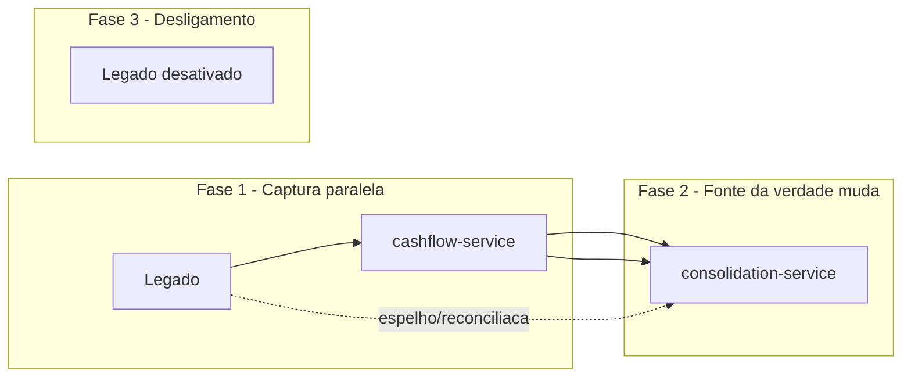

# 09 — Arquitetura de Transição (convivência com o legado)

> Diferencial pedido pelo enunciado: **como migrar** do estado atual (fechamento manual
> do caixa / sistema legado) para a arquitetura alvo **sem big-bang** e **sem perder dado**.

## 1. Premissas de partida (a confirmar com o cliente)

- Existe um **sistema legado** (ou planilha/fechamento manual) que hoje detém os lançamentos.
- Há **histórico** de lançamentos a preservar.
- O comerciante **não pode parar** de operar durante a migração.

## 2. Estratégia: Strangler Fig (crescimento incremental)

Não reescrever tudo de uma vez. **Construir o novo ao lado do antigo** e migrar o fluxo
por partes, com o antigo encolhendo até ser desligado.

## 3. Fases

### Fase 0 — Preparação
- Definir **contrato de migração** e **mapa de campos** legado → novo.
- **Backfill** do histórico: importar lançamentos passados (com evento sintético para o consolidado).
- Critério de saída: histórico carregado e saldo de dias passados **reconciliado** com o legado.

### Fase 1 — Captura paralela (dual-run)
- Novos lançamentos passam pelo **`cashflow-service`**; o **legado continua** como fonte durante a caneca.
- **Reconciliação diária:** comparar saldo novo × saldo legado.
- Critério de saída: **N dias consecutivos** de saldo idêntico (ex.: 10 dias).

### Fase 2 — Corte da fonte da verdade
- O `cashflow-service` passa a ser **fonte da verdade**; o legado vira **espelho read-only** (consulta por segurança).
- Consolidação oficial passa a ser do `consolidation-service`.
- Critério de saída: consultas migradas e validadas; nenhum acesso de escrita no legado.

### Fase 3 — Desligamento
- Desativar o legado; manter **backup** e trilha por retenção legal.
- Critério de saída: legado off, monitoramento estável, runbook atualizado.

## 4. Riscos da transição e mitigação

| Risco | Impacto | Mitigação |
|---|---|---|
| Divergência de saldo entre legado e novo | Alto | Reconciliação diária automatizada + alerta de divergência |
| Perda de lançamento na caneca | Alto | Fonte única de escrita por fase (sem escrita dupla cega) |
| Mapa de campos incorreto no backfill | Médio | Amostragem + validação de totais (Σ legado = Σ novo) |
| Mudança de regra no meio do caminho | Médio | Contrato congelado; exceções via ADR |
| Resistência operacional | Médio | Treinamento + período de leitura paralela |

## 5. Rollback por fase

| Fase | Como reverter |
|---|---|
| Fase 1 | Desligar captura paralela; legado **nunca deixou de ser** a fonte |
| Fase 2 | Reverter a fonte da verdade para o legado; novo vira consulta |
| Fase 3 | Reativar legado a partir do backup |

> **Princípio:** cada fase tem **ponto de retorno**. A escrita dupla **não** é usada às
> cegas — a fonte de verdade é **uma só por fase**, evitando divergência silenciosa.

## 6. Critérios de aceite da transição

- [ ] Histórico migrado e reconciliado (totais batem).
- [ ] N dias de saldo idêntico novo × legado.
- [ ] Nenhuma perda de lançamento (auditado).
- [ ] Consultas migradas e validadas.
- [ ] Legado desativado com backup e trilha preservados.
- [ ] Runbook e monitoramento documentados.

## 7. Nota de governança

A transição é o **maior risco** de um projeto assim — mais que a tecnologia. Ela exige
**reconciliação**, **critérios de saída por fase** e **ponto de rollback**, com o negócio
coproprietário do critério de aceite (não só do cronograma).
